# CallCraft 📱✨

[](https://github.com/sachinmandawi/Call-Craft/releases/tag/v1.0.0)
[](https://github.com/sachinmandawi/Call-Craft)
[](https://developer.android.com/jetpack/compose)
[-6750A4)](https://m3.material.io)
[](LICENSE)

**CallCraft** (`com.callcraft.studio`) is an ultra-modern, privacy-first Android Call Log Editor and Manager built with **Kotlin**, **Jetpack Compose**, and the **Material You (Dynamic Lilac)** design language.

It also features a built-in **React + Vite + Tailwind** live web simulator in `preview/` for instant browser testing.

---

## 📸 Screenshots Showcase

<div align="center">

### 1. Home & Call Log Management
| Recents History | Contact Call History | Multi-Select & Batch Mode | Missed Calls Filter |
| :---: | :---: | :---: | :---: |
| 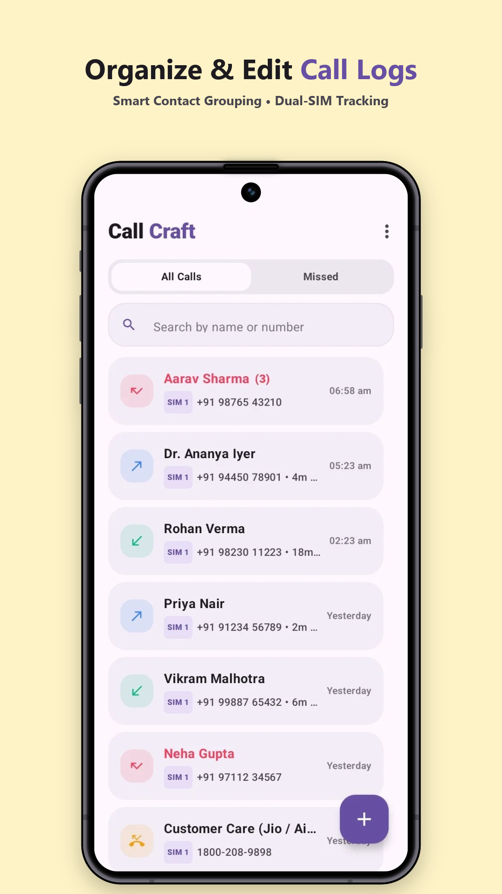 | 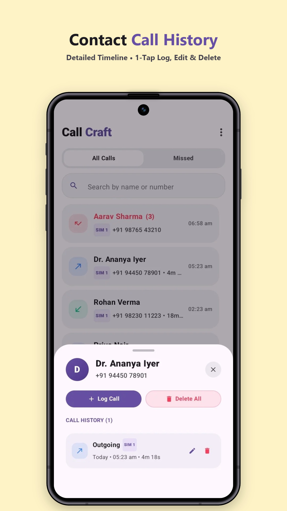 | 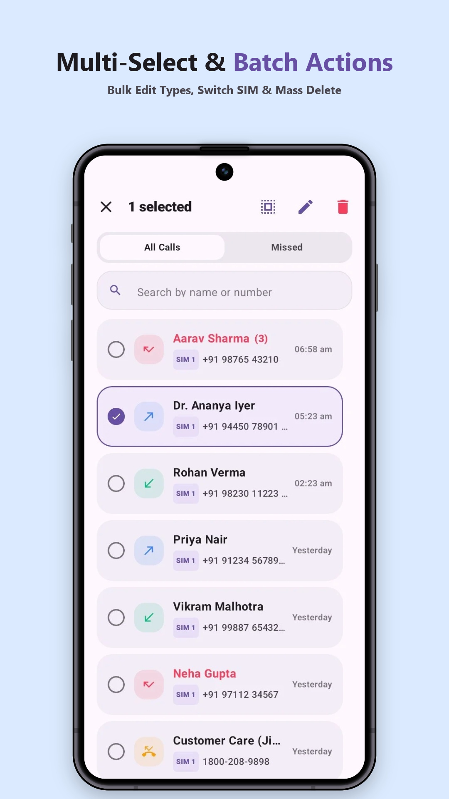 | 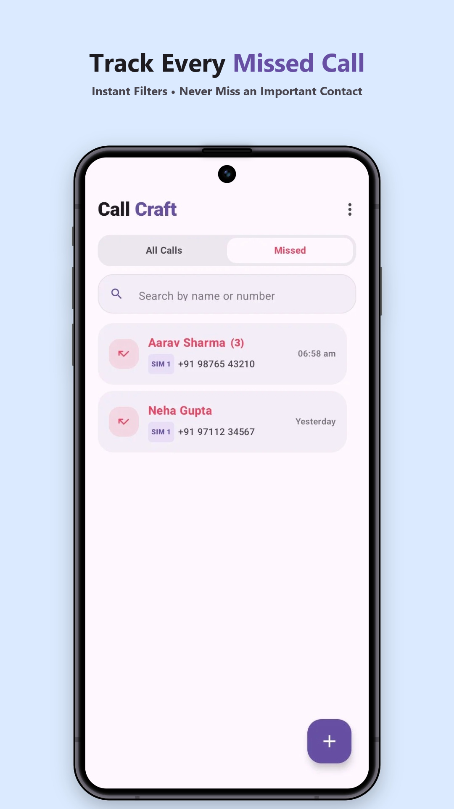 |
| *Smart contact grouping & Dual-SIM tracking* | *Detailed timeline with 1-tap edit & delete* | *Bulk edit types, switch SIM & mass delete* | *Instant filter for missed contact entries* |

<br />

### 2. Add / Edit & Android XML Backup Engine
| Quick Call Entry | Precision Duration & Time | Android Default XML Backup | Settings & Privacy |
| :---: | :---: | :---: | :---: |
| 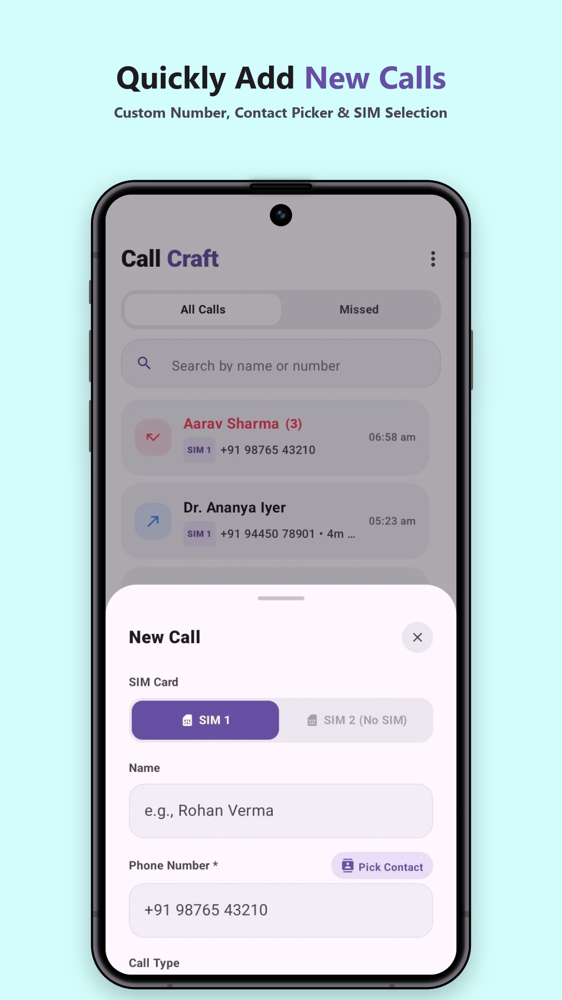 | 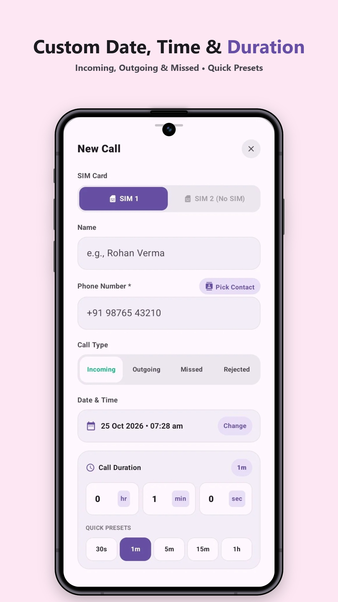 | 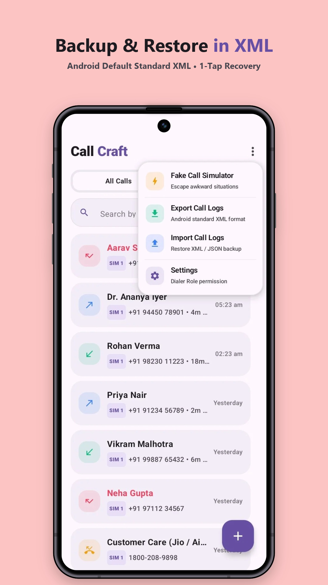 | 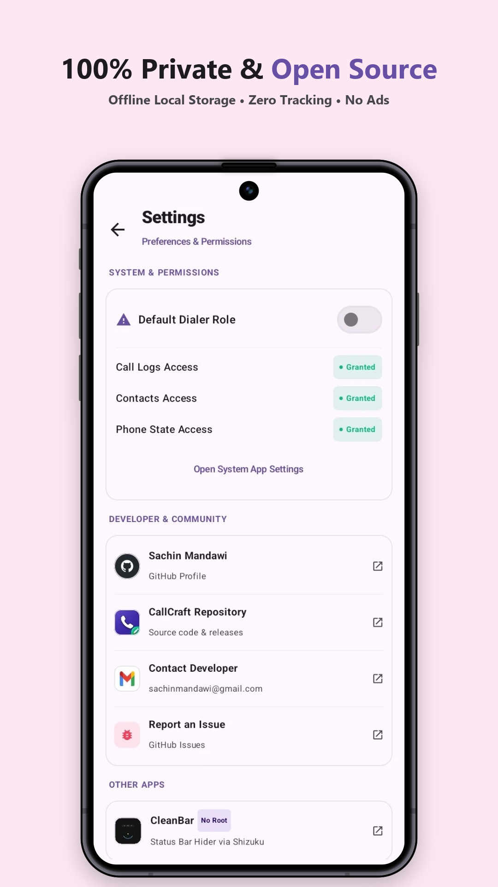 |
| *Add custom numbers with contact picker* | *Duration presets (30s, 1m, 5m, 1h) & date picker* | *Standard XML export & import (SMS Backup compatible)* | *Dialer role permission & offline local storage* |

<br />

### 3. Realistic Fake Call Simulator
| 4 OS Brand Themes | Timers & Ringtone Sound | Authentic Incoming Screen | Interactive In-Call Screen |
| :---: | :---: | :---: | :---: |
| 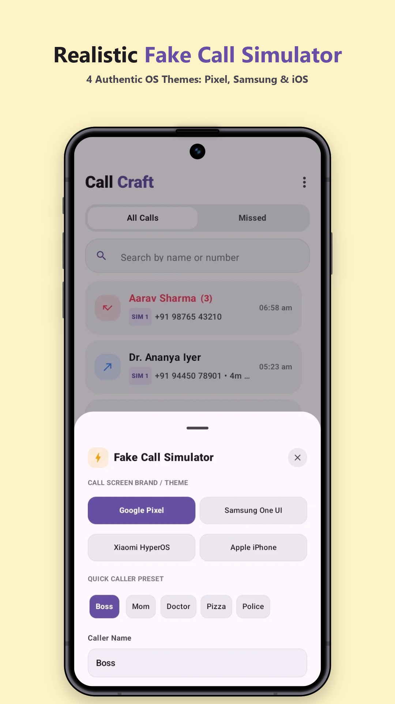 | 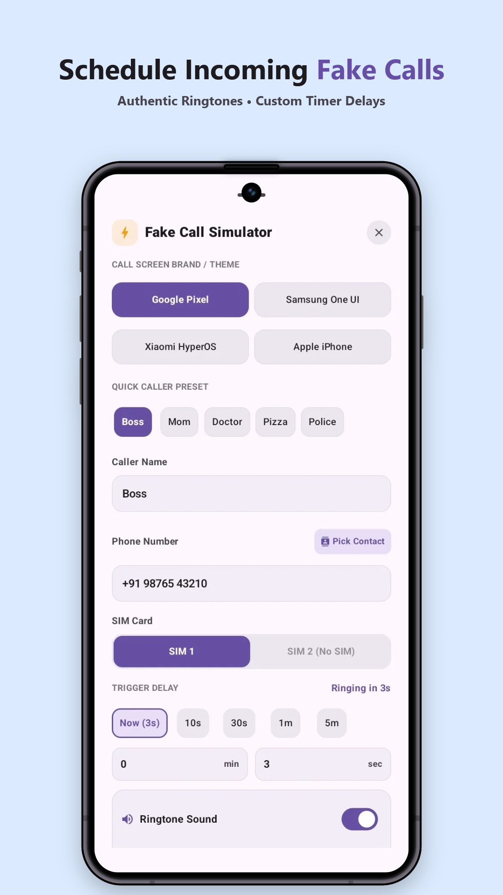 | 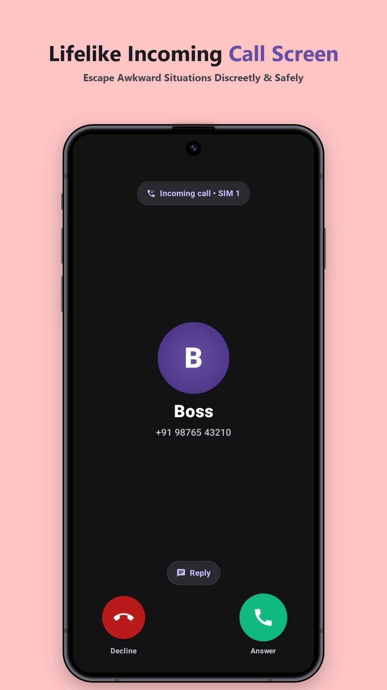 | 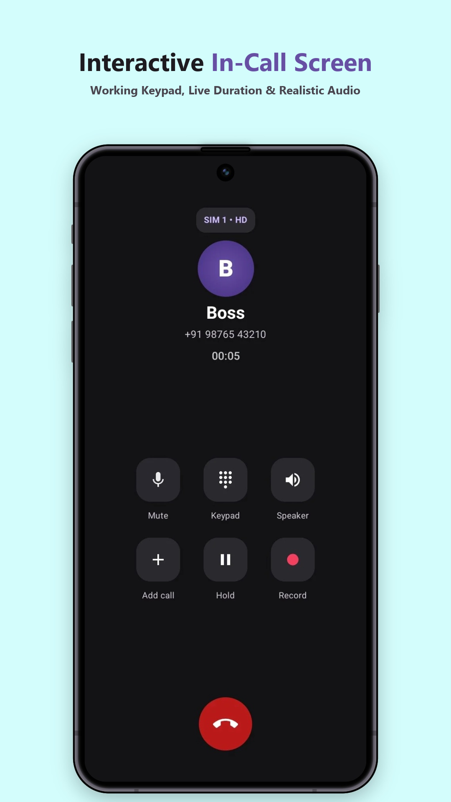 |
| *Pixel, Samsung One UI, Xiaomi & iOS themes* | *Countdown triggers (3s, 10s, 30s) + vibration* | *Realistic slide-to-answer interface* | *Working keypad, live duration & realistic audio* |

</div>

---

## ⚡ Key Features

- **Google Phone Standard Grouping**:
  - Automatically aggregates call history by contact name or clean normalized phone number.
  - **Consecutive Missed Calls Badge**: Alert counter `(X)` appears strictly when 2+ consecutive missed calls occur; answered calls display clean contact titles with zero clutter.
- **Contact Call History Bottom Sheet**:
  - Tap any contact card to view full chronological call history with individual duration, timestamp, SIM slot, and 1-tap edit/delete actions.
- **Hardware-Aware Dual SIM Tracking (SIM 1 vs SIM 2)**:
  - Real-time SIM slot detection via Android `SubscriptionManager`.
  - Empty slots are disabled and styled as `SIM X (No SIM)`.
- **Android Default Standard XML Backup & Restore**:
  - Generates standard Android CallLog XML files (`calls_backup_YYYY-MM-DD.xml`) compatible with tools like *SMS Backup & Restore*.
  - Full restore support with JSON fallback for complete data portability.
- **Multi-Select & Bulk Operations**:
  - Long-press to activate multi-select mode.
  - Bulk convert call types (Incoming, Outgoing, Missed, Rejected).
  - Bulk change SIM assignment across selected entries.
  - Complete contact group batch deletion with zero ghost records.
- **Realistic Fake Call Simulator**:
  - 4 authentic brand caller themes (Google Pixel, Samsung One UI, Xiaomi HyperOS, Apple iPhone).
  - Configurable countdown timer (Now 3s, 10s, 30s, 1m, 5m).
  - Working ringtone loop, vibration patterns, and interactive in-call controls.
- **100% Private & Offline**:
  - No internet permissions required for call management.
  - Zero analytics, zero telemetry, and zero ads.

---

## 📂 Project Structure

```
Call Log editor/
├── app/                                 # Native Android Application (Jetpack Compose)
│   ├── src/main/java/com/callcraft/studio/
│   │   ├── MainActivity.kt              # Compose UI, Navigation & Action Sheets
│   │   ├── data/
│   │   │   ├── CallLogItem.kt           # Models & Contact Grouping Structures
│   │   │   └── CallLogRepository.kt     # 3-Tier CallLog ContentResolver & XML Engine
│   │   └── service/
│   │       └── FakeCallHelper.kt        # Audio & Vibration Trigger System
│   └── build.gradle.kts
├── preview/                             # Live Web Simulator (React + Vite + Tailwind)
│   ├── src/
│   │   ├── App.tsx                      # Interactive Pixel Device Simulator
│   │   └── main.tsx
│   └── package.json
└── playstore_market_assets/             # High-Resolution Play Store Marketing Graphics
    ├── android_1_1.jpg ... android_1_13.jpg
```

---

## 🛠️ Building & Running

### Android Native App
Requires Android Studio / JDK 17+.

```bash
# Compile and build Debug APK
./gradlew assembleDebug

# Output APK location
app/build/outputs/apk/debug/CallCraft-v1.0.0.apk
```

### Direct APK Download
You can download the pre-built APK directly from our releases:
- [📥 Download CallCraft-v1.0.0.apk](https://github.com/sachinmandawi/Call-Craft/releases/download/v1.0.0/CallCraft-v1.0.0.apk)

### Web Simulator (Preview)
Requires Node.js 18+.

```bash
cd preview
npm install
npm run dev
# Open http://localhost:5173
```

---

## 📄 License
Open source under the [MIT License](LICENSE). Built with ❤️ by **Sachin Mandawi**.
